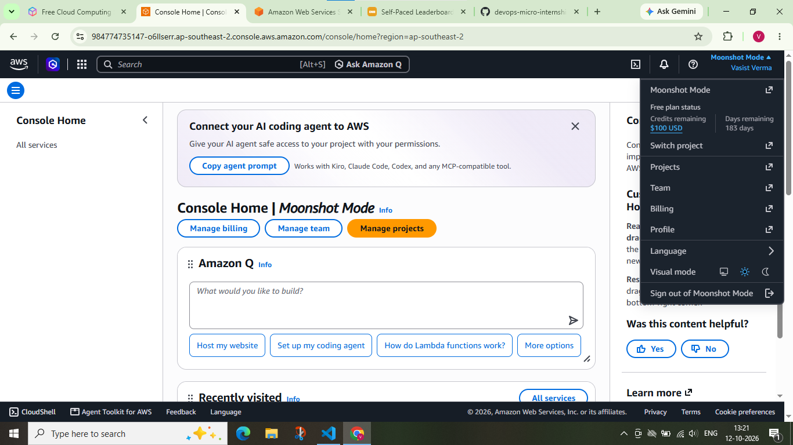
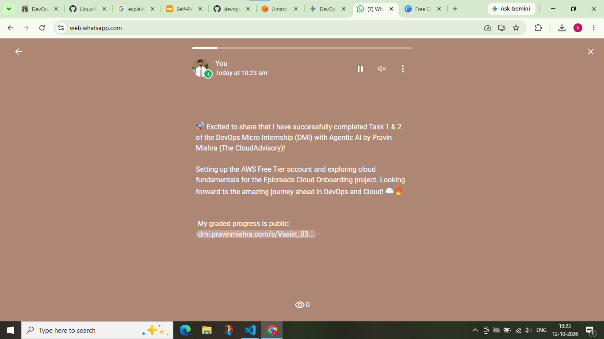

# Assignment 1 — AWS Free Tier Account Setup (EpicReads Cloud Onboarding)

Part of the DevOps Micro Internship (DMI) Cohort 3 with Agentic AI

---

## Purpose

In this assignment, you will create and verify an AWS Free Tier account as part of onboarding EpicReads — an online bookstore moving to the cloud. You will demonstrate an understanding of AWS fundamentals, Free Tier services, and account setup by answering conceptual questions and capturing proof of a working AWS Console login.

---

# Task 1 — Understanding AWS & Free Tier

## Goal

Demonstrate understanding of AWS basics and Free Tier usage by answering the following questions in your own words (3–4 lines each).

### Answers

#### Question 1 — What is an AWS account, and why do you need it at this stage?

An AWS account serves as a dedicated administrative container and unique identity that grants a user or organization access to the vast array of cloud computing services offered by Amazon Web Services. It provides a secure, centralized framework for managing identity and access (via IAM), monitoring resource utilization, and handling billing and payments through a single dashboard.

At this specific stage of the DevOps Micro Internship, having an AWS account is critical because it transforms theoretical knowledge into practical skill. To onboard EpicReads, we need a live environment to provision virtual servers, configure networking, and manage storage. Without an account, it would be impossible to experiment with real-world cloud architecture, test the deployment of microservices, or understand the nuances of cloud security and scalability in a production-like setting.

---

#### Question 2 — What is AWS Free Tier, and how long does it last?

The AWS Free Tier is a comprehensive onboarding program designed to lower the barrier to entry for developers and students by allowing them to use specific AWS services at no cost, provided they stay within predefined usage limits. This program is divided into three distinct categories to accommodate different learning curves:
1. **Always Free:** These offers do not expire and are available to all AWS customers regardless of when they signed up (e.g., certain Lambda or DynamoDB limits).
2. **12 Months Free:** These are available only for the first year following the initial sign-up date. They are ideal for those learning the core pillars of cloud computing, such as compute (EC2) and storage (S3).
3. **Trials:** These are short-term, limited-time offers that provide free access to high-end or specialized services for a few days or months after activation.

---

#### Question 3 — Name three AWS Free Tier services and their free usage limits.

1. **Amazon Elastic Compute Cloud (EC2):**
   The Free Tier provides **750 hours per month** of Linux or Windows instances using the `t2.micro` or `t3.micro` family. This is sufficient to run a single small server continuously for an entire month, allowing learners to host lightweight web applications or development environments for the first 12 months.

2. **Amazon Simple Storage Service (S3):**
   Users receive **5 GB of standard storage** for the first 12 months. In addition to the storage capacity, the free tier includes **20,000 GET requests** (downloading/reading data) and **2,000 PUT, COPY, POST, or LIST requests** (uploading/writing data) per month, which is ample for hosting static website assets or storing project backups.

3. **Amazon Relational Database Service (RDS):**
   For the first 12 months, AWS offers **750 hours per month** of managed database instances. This applies to `db.t2.micro`, `db.t3.micro`, or `db.t4g.micro` instances for engines like MySQL, PostgreSQL, or MariaDB. This allows for the creation of a fully managed relational database without the overhead of manual installation and patching.

---

# Task 2 — Create AWS Free Tier Account

## Goal

Create a valid AWS Free Tier account and sign in to the AWS Management Console.

> No screenshots required for this task. Completion is verified through Task 3.

---

# Task 3 — Verify AWS Account

## Goal

Confirm that your AWS account setup is complete by navigating to the Account section and capturing proof.

### Evidence

#### Screenshot 1 — AWS Account page showing account name (email may be blurred)

# Task 4 — Share Your AWS Cloud Onboarding Progress

## Goal

Share your AWS cloud onboarding progress on WhatsApp Status and provide evidence of the published status.

### Evidence

### Screenshot 2 — Published WhatsApp Status showing your AWS onboarding message and leaderboard progress link visible

---

# Submission Instructions

- Add all required screenshots in your GitHub repository submission
- Full name must be visible in required screenshots
- Do not expose sensitive information (keys, passwords, account IDs)

---

# Completion Checklist

- [✅] Task 1 answers written in own words
- [✅] AWS Free Tier account created successfully
- [✅] Signed in to AWS Management Console
- [✅] Screenshot of AWS Account page captured (full name visible, no sensitive data)
- [✅] All required screenshots added to repository

---

## 📌 About DMI & CloudAdvisory

DevOps Micro Internship (DMI) is a project-based DevOps program run by Pravin Mishra (The CloudAdvisory) focused on real-world execution, systems thinking, and career readiness.

It helps learners build strong DevOps foundations with hands-on experience.

---

## 📌 Resources

- 🌐 DMI Official Website: https://dmi.pravinmishra.com?utm_source=github&utm_medium=readme  
- 🎓 University: https://university.pravinmishra.com?utm_source=github&utm_medium=readme  
- 💬 Discord Community: https://discord.pravinmishra.com?utm_source=github&utm_medium=readme  
- 📝 Blog: https://dmi.pravinmishra.com/blog?utm_source=github&utm_medium=readme  
- ▶️ YouTube Playlist: https://www.youtube.com/playlist?list=PLFeSNDtI4Cho  
- 🔗 Pravin Mishra (LinkedIn): https://www.linkedin.com/in/pravin-mishra-aws-trainer/  
- 🏢 CloudAdvisory (LinkedIn): https://www.linkedin.com/company/thecloudadvisory/

---

*This submission is part of DevOps Micro Internship (DMI) Cohort 3 — Agentic AI Track.*